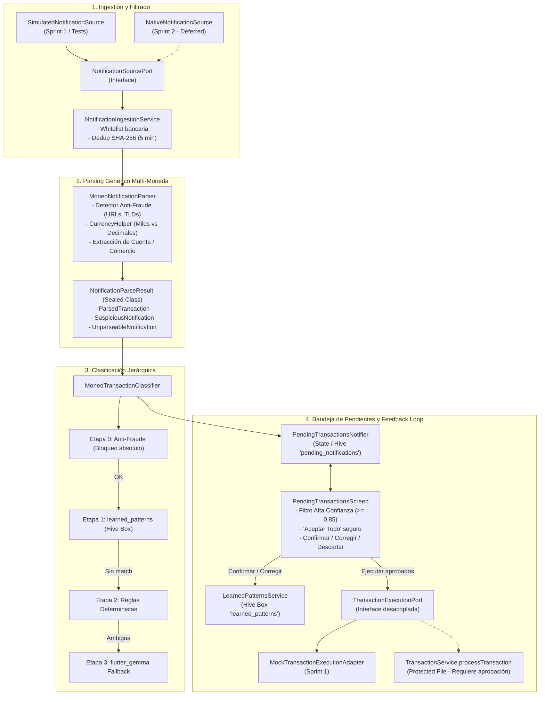

# Plan de Arquitectura y Diseño Técnico — Sprint 1: Notificaciones Bancarias Offline

> **Módulo:** `sprint-1-notificaciones`  
> **Fase:** PLAN (Spec Kit + EGM)  
> **Fecha:** 2026-11-13  
> **Documento predecesor:** [.specify/sprint-1-notificaciones/spec.md](file:///Volumes/ADATA%20SD620/Programacion%207.0/moneo/finazaap/.specify/sprint-1-notificaciones/spec.md)  
> **Fuente de verdad arquitectónica:** [PROJECT_AUDIT.md](file:///Volumes/ADATA%20SD620/Programacion%207.0/moneo/finazaap/docs/discovery/PROJECT_AUDIT.md)

---

## 1. Visión General de Arquitectura

Para incorporar la ingesta, parsing, clasificación y revisión de notificaciones bancarias sin poner en riesgo la estabilidad de Moneo (`finazaap`) ni violar las reglas de archivos protegidos, adoptamos una **arquitectura en capas hexagonal (Ports & Adapters)** contenida en `lib/features/notifications/`.



---

## 2. Contratos de Datos y Tipado Estricto (Dart 3)

### 2.1 Evento de Notificación Crudo
```dart
class NotificationEvent {
  final String id;
  final String packageName;
  final String title;
  final String body;
  final DateTime timestamp;

  const NotificationEvent({
    required this.id,
    required this.packageName,
    required this.title,
    required this.body,
    required this.timestamp,
  });

  String get deduplicationKey =>
      '$packageName|${title.trim()}|${body.trim()}|${timestamp.millisecondsSinceEpoch ~/ 300000}';
}
```

### 2.2 Resultado del Parser (`NotificationParseResult` Sealed Class)
Siguiendo `dart-use-pattern-matching`:
```dart
sealed class NotificationParseResult {
  final String status;
  final double confidence;
  final bool requiresReview;
  final bool autoProcessable;
  final List<String> flags;

  const NotificationParseResult({
    required this.status,
    required this.confidence,
    required this.requiresReview,
    required this.autoProcessable,
    this.flags = const [],
  });
}

class ParsedTransaction extends NotificationParseResult {
  final String tipo; // 'gasto', 'ingreso', 'transferencia', 'desconocido'
  final double monto;
  final String moneda; // 'COP', 'USD', etc.
  final String? comercio;
  final DateTime fecha;
  final AccountHint? cuenta;

  const ParsedTransaction({
    required this.tipo,
    required this.monto,
    required this.moneda,
    this.comercio,
    required this.fecha,
    this.cuenta,
    required double confidence,
    required bool requiresReview,
    required bool autoProcessable,
    List<String> flags = const [],
  }) : super(
          status: 'parsed',
          confidence: confidence,
          requiresReview: requiresReview,
          autoProcessable: autoProcessable,
          flags: flags,
        );
}

class SuspiciousNotification extends NotificationParseResult {
  final String rawText;
  final String reason;

  const SuspiciousNotification({
    required this.rawText,
    required this.reason,
    List<String> flags = const ['anti_fraud_link_detected'],
  }) : super(
          status: 'sospechosa',
          confidence: 0.0,
          requiresReview: true,
          autoProcessable: false,
          flags: flags,
        );
}

class UnparseableNotification extends NotificationParseResult {
  final String rawText;
  final String reason;

  const UnparseableNotification({
    required this.rawText,
    required this.reason,
  }) : super(
          status: 'unparseable',
          confidence: 0.0,
          requiresReview: true,
          autoProcessable: false,
          flags: const ['non_transactional_text'],
        );
}
```

### 2.3 Clasificación de Transacción (`TransactionClassification`)
```dart
class TransactionClassification {
  final String classification; // 'gasto', 'ingreso', 'transferencia-propia', 'sospechosa'
  final String? moneoType; // 'Expenses', 'Income', 'Transfer', null
  final String? category;
  final String? accountName;
  final String? destinationAccount;
  final double confidence;
  final bool requiresReview;
  final bool createTransaction;
  final String decisionSource; // 'anti_fraud', 'learned_patterns', 'deterministic_rules', 'gemma_fallback', 'fallback_ambiguous'

  const TransactionClassification({
    required this.classification,
    this.moneoType,
    this.category,
    this.accountName,
    this.destinationAccount,
    required this.confidence,
    required this.requiresReview,
    required this.createTransaction,
    required this.decisionSource,
  });
}
```

---

## 3. Diseño de Componentes e Interfaces

### 3.1 `NotificationIngestionService`
- **Responsabilidad:** Filtrar paquetes contra `BankWhitelistService`, calcular hash temporal `SHA-256`, y encolar eventos válidos.
- **Whitelist predeterminada (Colombia y Billeteras comunes):**
  - Bancolombia: `com.bancolombia.personas`
  - Nequi: `com.nequi.MobileApp`
  - Davivienda: `com.davivienda.billetera`
  - Daviplata: `co.daviplata`
  - Nu Colombia: `com.nu.production`
  - BBVA Colombia: `co.com.bbva.mb`
  - Scotiabank Colpatria: `com.scotiabank.colpatria`
  - Banco Falabella: `com.bancofalabella.mobile`
- **Ventana de deduplicación:** Bloques discretos de 5 minutos ($\Delta t = 300\text{ s}$). Si llega un evento con el mismo `SHA256(package + title + body + bucket)`, se ignora.

### 3.2 `MoneoNotificationParser`
- **Responsabilidad:** Extracción agnóstica de campos sin plantillas rígidas por banco.
- **Filtro Anti-Fraude:**
  ```dart
  static final _urlRegex = RegExp(r'(https?:\/\/|www\.)[^\s]+', caseSensitive: false);
  static final _phishingShorteners = RegExp(
    r'(bit\.ly|tinyurl\.com|t\.co|cutt\.ly|rb\.gy|wa\.me|\.xyz|\.top|\.click)',
    caseSensitive: false,
  );
  ```
  Si se detecta cualquier coincidencia, detiene la extracción inmediatamente y retorna `SuspiciousNotification`.
- **Parsing de Montos con `CurrencyHelper`:**
  - Identifica el token de valor con regex de divisas (`\$|COP|USD|MXN|S\/|€|£`).
  - Inspecciona la estructura numérica:
    - Si contiene punto y tres dígitos finales en contexto COP/Latino (ej. `45.000` o `1.250.000,50`), normaliza punto como separador de miles.
    - Si contiene coma y dos decimales (ej. `120,50`), normaliza coma como decimal.
    - Si la notación es ambigua (ej. `1.234` sin sufijo ni contexto), emite `confidence = 0.50` y `requiresReview = true`.

### 3.3 `MoneoTransactionClassifier`
- **Etapa 0 — Anti-Fraude:** Valida si `parseResult is SuspiciousNotification` o si existen frases de alarma/urgencia (`cuenta bloqueada`, `ingresa aquí`, `actualiza tus datos`). En tal caso retorna `decisionSource: 'anti_fraud'`, `createTransaction: false`.
- **Etapa 1 — Learned Patterns (`Hive` box `"learned_patterns"`):**
  - Normaliza nombre de comercio: minúsculas, sin puntuación ni acentos (ej. `Éxito Laureles 034` → `exito laureles`).
  - Si la entrada existe con `confirmations >= 1`, toma categoría, cuenta y tipo del historial.
- **Etapa 2 — Reglas Deterministas:**
  - Compara indicios de cuenta origen y cuenta destino contra las cuentas activas del usuario (`AccountItem`). Si ambas coinciden, marca `transferencia-propia`.
  - Palabras clave de abono → `ingreso` (`Income`).
  - Palabras clave de débito → `gasto` (`Expenses`).
- **Etapa 3 — Fallback Gemma (`GemmaClassifierAdapter`):**
  - Se ejecuta en aislamiento con timeout (3 segundos). Si la memoria RAM o el estado del modelo fallan, retorna `fallback_ambiguous` sin lanzar excepciones.

### 3.4 `PendingTransactionsNotifier` y Feedback Loop
- **Responsabilidad:** Gestionar la lista de transacciones pendientes en memoria y respaldada en caja Hive `pending_notifications`.
- **Acción "Aceptar todo":**
  ```dart
  Future<BatchApprovalSummary> acceptAllEligible() async {
    final eligible = _items.where((item) =>
      item.classification != 'sospechosa' &&
      !item.requiresReview &&
      item.confidence >= 0.85 &&
      item.accountName != null
    ).toList();

    for (final item in eligible) {
      await _confirmItem(item);
    }
    
    return BatchApprovalSummary(
      acceptedCount: eligible.length,
      remainingCount: _items.length - eligible.length,
    );
  }
  ```
- **Persistencia en `learned_patterns`:**
  - Al confirmar: `confirmations++`.
  - Al corregir: sobrescribe categoría/cuenta, fija `confirmations = 1`, `lastCorrectedAt = DateTime.now()`.

---

## 4. Estrategia de Desacoplamiento de Archivos Protegidos

De acuerdo con [AGENTS.md](file:///Volumes/ADATA%20SD620/Programacion%207.0/moneo/finazaap/AGENTS.md) y [.agents/rules/archivos-protegidos.md](file:///Volumes/ADATA%20SD620/Programacion%207.0/moneo/finazaap/.agents/rules/archivos-protegidos.md), los siguientes archivos no se modificarán:

1. **`lib/data/transaction_service.dart`:**
   - **Mecanismo:** Creamos la interfaz `TransactionExecutionPort`:
     ```dart
     abstract class TransactionExecutionPort {
       Future<bool> executeTransaction({
         required String type,
         required double amount,
         required String accountName,
         String? destinationAccount,
         String? detail,
       });
     }
     ```
   - En el Sprint 1 proveemos `MockTransactionExecutionAdapter` para pruebas unitarias y de widgets. La implementación concreta que llamará a `TransactionService.processTransaction` queda encapsulada para cuando se solicite formalmente la autorización en Sprint 2.
2. **`android/app/AndroidManifest.xml` y `MainActivity.kt`:**
   - **Mecanismo:** Creamos la interfaz `NotificationSourcePort`:
     ```dart
     abstract class NotificationSourcePort {
       Stream<NotificationEvent> get notificationStream;
       Future<NotificationSourceStatus> checkStatus();
     }
     ```
   - En Sprint 1 implementamos `SimulatedNotificationSource` que permite alimentar la bandeja mediante un generador controlado de notificaciones de prueba.
3. **`lib/data/model/*.g.dart`:**
   - **Mecanismo:** Los nuevos modelos `PendingTransactionItem` y `LearnedPattern` se guardan en cajas Hive independientes con serialización `toJson()` / `fromJson()` manual o TypeAdapters registrados con IDs libres (ej. `typeId: 10`, `11`), sin tocar `add_date.g.dart` (`typeId: 1`) ni `responsibility.g.dart` (`typeId: 2`).

---

## 5. Análisis de Trade-Offs (EGM)

| Decisión | Opción A (Elegida) | Opción B (Descartada) | Justificación y Modos de Falla |
| :--- | :--- | :--- | :--- |
| **Parsing de notificaciones** | Heurística genérica de tokens + validación cruzada. | Expresiones regulares rígidas por banco (`com.bancolombia`, etc.). | Opción B falla cada vez que un banco actualiza su texto. Opción A es adaptable pero requiere umbral de confianza (`< 0.80`) ante ambigüedades. |
| **Rol de Gemma (`flutter_gemma`)** | Fallback de última milla (Etapa 3) solo ante ambigüedad. | Extractor LLM primario para cada notificación entrante. | Gemma pesa ~2.58 GB y requiere >=4 GB RAM; en background o dispositivos de gama baja falla por OOM. El clasificador determinista es instantáneo (<2 ms) y 100% offline. |
| **Aceptación masiva ("Aceptar todo")** | Filtro estricto (`confidence >= 0.85`, no sospechosa, cuenta lista). | Aceptar todos los elementos en la bandeja con un solo botón. | Opción B podría contaminar la contabilidad del usuario con transacciones de phishing o montos mal interpretados. |
| **Persistencia de la bandeja** | Caja Hive separada `'pending_notifications'`. | Agregar campos a la caja existente `'data'` con flag `isPending`. | Modificar `'data'` arriesga romper los cálculos de `TransactionService` y `add_date.g.dart`. La caja separada garantiza aislamiento contable absoluto. |

---

## 6. Seguridad y Validación Offline

1. **Anti-Phishing y Coacción:** Bloqueo incondicional de URLs, acortadores y textos de urgencia antes de procesar cualquier número.
2. **Sin fuga de datos (Offline First):** Ningún payload ni texto se transmite a servicios cloud; Moneo opera estrictamente local.
3. **Sanitización de Logs:** Se prohibe el uso de `print(notification.rawText)` o `print(amount)`. Los logs de depuración solo emiten códigos de evento sanitizados (ej. `[NotifIngest] Event enqueued: id=... package=...`).
4. **Verificación Determinista:** Los scripts de las skills garantizan que ningún cambio introduzca regresiones en los invariantes JSON.
