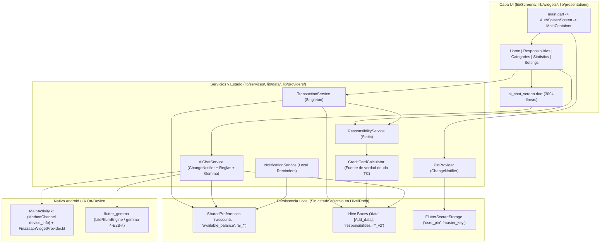

# Auditoría Técnica — Moneo (`finazaap`)

> **Fecha:** 2026-11-13  
> **Rama analizada:** `chore/agy-audit` (`2369699`)  
> **Alcance:** Análisis estático de solo lectura. No se modificó código ni se ejecutaron comandos destructivos.

---

## 1. Resumen ejecutivo

**Moneo (`finazaap`)** es una app móvil/web de finanzas personales 100% offline desarrollada en Flutter/Dart, con un asistente de IA on-device basado en `flutter_gemma` (`gemma-4-E2B-it`) y un simulador financiero por reglas como respaldo. Se encuentra en estado de **MVP funcional / prototipo avanzado**, no apto aún para producción: mantiene `applicationId` de ejemplo (`com.example.finazaap`), firma release con `debug`, carece de suite de pruebas real y presenta una brecha crítica de seguridad respecto a lo prometido en su documentación (las cajas de Hive y `SharedPreferences` almacenan transacciones y saldos en texto plano, sin cifrado AES-256 efectivo).

Para incorporar la **lectura de notificaciones bancarias en Android (`NotificationListenerService`) y aprendizaje continuo**, la app no cuenta todavía con infraestructura nativa de escucha en segundo plano ni un clasificador LLM conectado a transacciones; el parsing actual en chat es puramente heurístico/regex. El mayor riesgo técnico previo es la coexistencia de dos capas de persistencia desacopladas (`SharedPreferences` para cuentas y `Hive` para movimientos), archivos monolíticos de >1,500 líneas y ~5.17 GB de modelos `.litertlm` trackeados en Git.

---

## 2. Estado actual

| Área | Hallazgo | Evidencia (`ruta:línea`) | Confianza |
| :--- | :--- | :--- | :--- |
| **Identidad y estado** | App de finanzas personales 100% offline ("Moneo"), proyecto personal de Jesús Martínez bajo licencia CC BY-NC-ND 4.0. Estado MVP/prototipo (ID `com.example.finazaap`, firma `debug`). | [README.md](file:///Volumes/ADATA%20SD620/Programacion%207.0/moneo/finazaap/README.md#L1-L71), [build.gradle](file:///Volumes/ADATA%20SD620/Programacion%207.0/moneo/finazaap/android/app/build.gradle#L26-L40) | Alta |
| **Stack y SDK** | Dart SDK `>=3.0.0 <4.0.0`; Flutter/Dart CLI no disponibles en el host macOS (entorno definido en Docker Ubuntu 22.04 con `flutter-env`, actualmente detenido). | [pubspec.yaml](file:///Volumes/ADATA%20SD620/Programacion%207.0/moneo/finazaap/pubspec.yaml#L6-L7), [Dockerfile](file:///Volumes/ADATA%20SD620/Programacion%207.0/moneo/finazaap/Dockerfile#L1-L55), [Makefile](file:///Volumes/ADATA%20SD620/Programacion%207.0/moneo/finazaap/Makefile#L1-L62) | Alta |
| **Estado, DI y navegación** | Estado con `ChangeNotifier` (`PinProvider`, `AiChatService`, `ThemeNotifier`) + `setState`. Singletons estáticos sin contenedor DI. Navegación por `IndexedStack` (5 tabs) y `Navigator.push`. | [main_container.dart](file:///Volumes/ADATA%20SD620/Programacion%207.0/moneo/finazaap/lib/Screens/main_container.dart#L10-L48), [transaction_service.dart](file:///Volumes/ADATA%20SD620/Programacion%207.0/moneo/finazaap/lib/data/transaction_service.dart#L13-L22) | Alta |
| **Persistencia y modelo de datos** | Doble capa paralela: `SharedPreferences` (`'accounts'`, `'available_balance'`) y Hive (`'data'`, `'responsibilities'`, `'transactions_v2'`, `'accounts'`, `'accounts_v2'`). `Add_data.amount` es `String?`; `Responsibility` y `Account` usan `double`; sin `Decimal`/centavos. | [CLAUDE.md](file:///Volumes/ADATA%20SD620/Programacion%207.0/moneo/finazaap/CLAUDE.md#L47-L56), [add_date.dart](file:///Volumes/ADATA%20SD620/Programacion%207.0/moneo/finazaap/lib/data/model/add_date.dart#L6-L69), [responsibility.dart](file:///Volumes/ADATA%20SD620/Programacion%207.0/moneo/finazaap/lib/data/model/responsibility.dart#L8-L72) | Alta |
| **Moneda y zona horaria** | 12 monedas en `CurrencyHelper` (default `COP`). Fechas guardadas como `DateTime.now()` local; `timezone` solo se usa en recordatorios de `NotificationService`. Sin migraciones formales de BD. | [currency_helper.dart](file:///Volumes/ADATA%20SD620/Programacion%207.0/moneo/finazaap/lib/utils/currency_helper.dart#L6-L113), [notification_service.dart](file:///Volumes/ADATA%20SD620/Programacion%207.0/moneo/finazaap/lib/services/notification_service.dart#L36-L37) | Alta |
| **Chatbot e IA actual** | `AiChatService` (1,728 líneas) usa `flutter_gemma: ^1.0.2` (`LiteRtLmEngine` en móvil, `MediaPipeEngine` en Web) con `gemma-4-E2B-it.litertlm`. Fallback por defecto en móvil: simulador por reglas. Detección de gastos en chat es regex/palabras clave, no LLM. **0 referencias a `Jev` o `TypeSafe`**. | [ai_chat_service.dart](file:///Volumes/ADATA%20SD620/Programacion%207.0/moneo/finazaap/lib/services/ai_chat_service.dart#L61-L89), [ai_chat_service.dart](file:///Volumes/ADATA%20SD620/Programacion%207.0/moneo/finazaap/lib/services/ai_chat_service.dart#L1320-L1526), [device_capability_service.dart](file:///Volumes/ADATA%20SD620/Programacion%207.0/moneo/finazaap/lib/services/device_capability_service.dart#L5-L67) | Alta |
| **Notificaciones y Android** | Solo `flutter_local_notifications: ^19.2.0` para recordatorios locales. `AndroidManifest.xml` tiene `POST_NOTIFICATIONS`, `RECEIVE_BOOT_COMPLETED`, `SCHEDULE_EXACT_ALARM`. **No existe `NotificationListenerService`**. | [AndroidManifest.xml](file:///Volumes/ADATA%20SD620/Programacion%207.0/moneo/finazaap/android/app/src/main/AndroidManifest.xml#L2-L56), [MainActivity.kt](file:///Volumes/ADATA%20SD620/Programacion%207.0/moneo/finazaap/android/app/src/main/kotlin/com/example/finazaap/MainActivity.kt#L11-L35) | Alta |
| **Seguridad y privacidad** | Hive (`data`) se abre sin `HiveAesCipher`. `EncryptedHiveDataSource` y `SecurePreferencesDataSource` son código muerto sin uso real. `EncryptionService` usa IV fijo (`IV.fromLength(16)`) y fallback Base64. PIN guardado sin hash en `FlutterSecureStorage`. ~50 `print()` en `lib/`. | [main.dart](file:///Volumes/ADATA%20SD620/Programacion%207.0/moneo/finazaap/lib/main.dart#L76-L80), [encryption_service.dart](file:///Volumes/ADATA%20SD620/Programacion%207.0/moneo/finazaap/lib/core/security/encryption_service.dart#L42-L62), [pin_provider.dart](file:///Volumes/ADATA%20SD620/Programacion%207.0/moneo/finazaap/lib/providers/pin_provider.dart#L46-L54) | Alta |
| **Secretos y firmas** | No existen archivos `.env`, `*.jks`, `*.keystore`, `key.properties`, `google-services.json` ni `serviceAccount*.json` en el repo. `.gitignore` no incluye reglas para estos archivos ni para `*.litertlm` / `*.hive`. | [.gitignore](file:///Volumes/ADATA%20SD620/Programacion%207.0/moneo/finazaap/.gitignore#L1-L43), [build.gradle](file:///Volumes/ADATA%20SD620/Programacion%207.0/moneo/finazaap/android/app/build.gradle#L36-L46) | Alta |
| **Calidad y tests** | `dart analyze` y `flutter test` **NO VERIFICADOS** en vivo (sin Flutter CLI en host). Solo 2 archivos de test (`widget_test.dart` smoke test, `ai_chat_service_test.dart` 3 tests del simulador). `account_management.dart` importa paquete inexistente `settings_ui`. | [widget_test.dart](file:///Volumes/ADATA%20SD620/Programacion%207.0/moneo/finazaap/test/widget_test.dart#L1-L45), [ai_chat_service_test.dart](file:///Volumes/ADATA%20SD620/Programacion%207.0/moneo/finazaap/test/ai_chat_service_test.dart#L1-L87), [analyze_output.txt](file:///Volumes/ADATA%20SD620/Programacion%207.0/moneo/finazaap/analyze_output.txt#L1-L10) | Alta |
| **Git y archivos grandes** | Rama `chore/agy-audit` (= `main`, commit `2369699`), working tree limpio. **Alerta:** `web/models/gemma.litertlm` y `assets/models/gemma.litertlm` (~2.58 GB c/u, ~5.17 GB total) están trackeados en Git. Sin submódulos ni CI/CD. | `git ls-files` + `ls -la`, [CLAUDE.md](file:///Volumes/ADATA%20SD620/Programacion%207.0/moneo/finazaap/CLAUDE.md#L71) | Alta |

---

## 3. Diagrama de arquitectura

**Acoplamientos y deuda estructural observada:**
- **God files:** `ai_chat_screen.dart` (3,094 líneas), `statistics.dart` (2,737), `add_expense.dart` (1,864), `ai_chat_service.dart` (1,728), `selecctaccount.dart` (1,680), `responsibilities_screen.dart` (1,628), `home.dart` (1,517).
- **Código muerto / duplicado:** `EncryptedHiveDataSource`, `SecurePreferencesDataSource`, `account_management.dart` (roto, sin dependencia `settings_ui`), y coexistencia de `Account` (`lib/data/model/account.dart`) con `AccountItem` (`lib/data/models/account_item.dart`).

---

## 4. Inventario del entorno de agentes

- **En el repositorio actual:**
  - **Presente:** Únicamente [CLAUDE.md](file:///Volumes/ADATA%20SD620/Programacion%207.0/moneo/finazaap/CLAUDE.md) (71 líneas, guía de arquitectura y comandos).
  - **Ausente:** No existen `AGENTS.md`, `GEMINI.md`, `.agents/`, `.gemini/`, `.specify/` (Spec Kit), `.mcp.json` ni hooks locales del proyecto.
- **Entorno global de `agy` (`agy --version` -> `1.5.8`, perfil `karoll`, `$HOME=/Users/jesusmartinez/.agys/profiles/karoll`):**
  - **Builtin skills activas (16 en `~/.agys/profiles/karoll/.gemini/antigravity-cli/builtin/skills/`):** `agy-customizations`, `antigravity_guide`, `automation`, `generative_ui`, `mcp-app-development`, `migrate-agent-settings`, `migrate-workflows`, `native_swarm`, `permissioned-github`, `plugin`, `run-workflow`, `swarm_monitor`, `swarm_narrator`, `ui-plugin-navigation` (en esta sesión están montadas: `agy-customizations`, `antigravity-guide`, `run-workflow`, `swarm`, `swarm_monitor`).
  - **MCPs configurados (`~/.agys/profiles/karoll/.gemini/antigravity-cli/mcp/`):** `filesystem`, `git`, `github`, `sequential-thinking`.
  - **Plugins:** No se detectó `egm` ni plugins instalados en `settings.json`.
  - **Hooks:** `agys statusline-hook` en `settings.json`.
  - **Ruta global de skills que funciona en `agy 1.5.8`:** Según [agy-customizations/SKILL.md](file:///Users/jesusmartinez/.agys/profiles/karoll/.gemini/antigravity-cli/builtin/skills/agy-customizations/SKILL.md#L52-L54), el descubrimiento global usa **`~/.gemini/config/`** (resuelto bajo el `$HOME` del perfil activo: `/Users/jesusmartinez/.agys/profiles/karoll/.gemini/config/`). Las rutas `~/.gemini/antigravity-cli/skills/` no existen; `/Users/jesusmartinez/.agents/skills/` contiene `find-skills` y `humanizer`, pero pertenece al `$HOME` del usuario macOS fuera del perfil `karoll`.

---

## 5. Zonas de riesgo y archivos protegidos sugeridos

Archivos críticos que **NO deben ser modificados por un agente sin revisión humana explícita**:

1. **Cálculo de saldos y deudas:**
   - [transaction_service.dart](file:///Volumes/ADATA%20SD620/Programacion%207.0/moneo/finazaap/lib/data/transaction_service.dart) — Única puerta de entrada para actualizar saldos en `SharedPreferences` y sincronizar con `ResponsibilityService` y `Hive`.
   - [credit_card_calculator.dart](file:///Volumes/ADATA%20SD620/Programacion%207.0/moneo/finazaap/lib/data/credit_card_calculator.dart) — Única fuente de verdad para deuda y cuotas de tarjetas de crédito.
   - [responsibility_service.dart](file:///Volumes/ADATA%20SD620/Programacion%207.0/moneo/finazaap/lib/data/responsibility_service.dart) — Lógica de ciclos de pago y obligaciones.
2. **Esquemas Hive y código generado (riesgo de corrupción de datos locales):**
   - [add_date.dart](file:///Volumes/ADATA%20SD620/Programacion%207.0/moneo/finazaap/lib/data/model/add_date.dart) y `add_date.g.dart` (`typeId: 1`).
   - [responsibility.dart](file:///Volumes/ADATA%20SD620/Programacion%207.0/moneo/finazaap/lib/data/model/responsibility.dart) y `responsibility.g.dart` (`typeId: 2`).
3. **Seguridad y acceso:**
   - [encryption_service.dart](file:///Volumes/ADATA%20SD620/Programacion%207.0/moneo/finazaap/lib/core/security/encryption_service.dart) y [pin_provider.dart](file:///Volumes/ADATA%20SD620/Programacion%207.0/moneo/finazaap/lib/providers/pin_provider.dart).
4. **Configuración Android / Build:**
   - [build.gradle](file:///Volumes/ADATA%20SD620/Programacion%207.0/moneo/finazaap/android/app/build.gradle), [AndroidManifest.xml](file:///Volumes/ADATA%20SD620/Programacion%207.0/moneo/finazaap/android/app/src/main/AndroidManifest.xml), [proguard-rules.pro](file:///Volumes/ADATA%20SD620/Programacion%207.0/moneo/finazaap/android/app/proguard-rules.pro).

---

## 6. Brechas para la funcionalidad de notificaciones bancarias y aprendizaje continuo

| Componente requerido | Qué ya sirve | Qué falta | Decisiones de arquitectura abiertas |
| :--- | :--- | :--- | :--- |
| **Captura en Android (`NotificationListenerService`)** | `MainActivity.kt` ya usa `MethodChannel` (`com.example.finazaap/device_info`). | Servicio nativo Kotlin heredando de `NotificationListenerService`, declaración en `AndroidManifest.xml` con `BIND_NOTIFICATION_LISTENER_SERVICE`, cola persistente cuando la app está cerrada (WorkManager/SQLite/SharedPrefs nativo) y UI para otorgar el permiso en Ajustes de Android. | ¿Procesar notificaciones en background puro (Kotlin -> cola local) o despertar motor Flutter/Dart en segundo plano? ¿Whitelist de paquetes bancarios configurables? |
| **Extracción (monto, comercio, fecha, cuenta)** | `CurrencyHelper` conoce formatos locales (ej. COP `.` miles / `,` decimales). `AiChatService` tiene regex básico en `detectAndGenerateTransactionSuggestions`. | Parser robusto multi-banco (los formatos de Bancolombia, Nequi, Davivienda, Nu, etc. varían mucho en separadores decimales y texto). | **Regex/plantillas por banco vs LLM on-device (`gemma-4-E2B-it`)**: Gemma pesa ~2.58 GB y requiere >=4 GB RAM; en gama media/baja o en background el regex es instantáneo y determinista, pero frágil ante cambios de copy bancario. |
| **Clasificación (gasto / ingreso / transferencia propia)** | `TransactionService.processTransaction()` ya soporta `'Income'`, `'Expenses'` y `'Transfer'` con `accountName` y `destinationAccount`. | Mapeo de texto de notificación -> cuenta local de `AccountItem` (ej. últimos 4 dígitos o alias de banco) y detector de transferencias entre cuentas propias (par débito/crédito en ventana de tiempo y mismo monto). | ¿Cómo vincular cuentas de Moneo con bancos reales (alias/últimos 4 dígitos)? ¿Ventana temporal de emparejamiento para transferencias propias? |
| **Deduplicación** | Ninguno. `Add_data` no tiene `externalId`, `sourceHash` ni `rawNotificationId`. | Campo único o tabla/box de notificaciones procesadas (`hash(paquete + timestamp_bucket + monto + texto)` o `StatusBarNotification.key`) para evitar registrar dos veces la misma alerta o duplicar transferencias. | ¿Agregar campos opcionales a `Add_data` (`HiveField(11+)`) o mantener una caja separada `notification_events` que referencie la transacción? |
| **Ciclo de aprendizaje con feedback** | `AiChatService` tiene `_userNotes` en `SharedPreferences` (texto libre generado por conteo). | Almacén estructurado de feedback (`comercio_normalizado -> categoría/tipo/cuenta` + historial de correcciones del usuario) e interfaz de confirmación/corrección rápida (bandeja de "movimientos detectados"). | ¿Aprendizaje determinista local (tabla de reglas/frecuencias comercio->categoría + few-shot en prompt de Gemma) o reentrenamiento/LoRA (no soportado nativamente en flujo actual)? |
| **Privacidad de datos bancarios** | App 100% offline hoy. | Si se mantiene Gemma on-device, ningún texto sale del teléfono. Falta cifrar Hive/SharedPrefs para proteger el historial crudo de notificaciones si se almacena. | Confirmar prohibición de enviar texto de notificaciones a APIs externas sin consentimiento ni anonimización. |

---

## 7. Preguntas abiertas para ti (priorizadas)

1. **[Crítica - Arquitectura IA]** Dado que `gemma-4-E2B-it` requiere >=4 GB de RAM y ~2.58 GB de descarga (y hoy el simulador por reglas es el modo por defecto en móvil), ¿el extractor/clasificador de notificaciones debe funcionar con **reglas/regex + diccionario aprendible sin depender de Gemma**, usando Gemma solo como respaldo opcional?
2. **[Crítica - Git]** `web/models/gemma.litertlm` y `assets/models/gemma.litertlm` (~5.17 GB en total) están actualmente trackeados en Git. ¿Deseas limpiarlos del historial/índice de Git y añadirlos a `.gitignore` antes de seguir trabajando con agentes?
3. **[Alta - Seguridad]** Hoy `Hive` (`data`) y `SharedPreferences` (`accounts`) guardan todo en texto plano a pesar de que `EncryptionService` existe. ¿Priorizamos activar cifrado real (`HiveAesCipher` + migración segura) antes de guardar textos crudos de notificaciones bancarias?
4. **[Alta - Alcance bancario]** ¿Para qué bancos o billeteras de qué país (ej. Colombia: Bancolombia, Nequi, Davivienda, Nu, etc.) necesitas soporte inicial de notificaciones, y qué formato de moneda manejan?
5. **[Alta - UX de confirmación]** Cuando llegue una notificación bancaria, ¿prefieres que se cree la transacción en estado **"pendiente de confirmar"** en una bandeja dedicada (para evitar contaminar saldos reales si el parser falla) o que afecte el saldo de inmediato con opción de corregir?
6. **[Media - Entorno `agy`]** ¿Quieres que creemos un `AGENTS.md` y `.agents/rules/` en el repo para proteger las zonas críticas (`TransactionService`, `CreditCardCalculator`, modelos Hive, `build.gradle`) y documentar que Flutter corre dentro de Docker?
7. **[Media - Transferencias propias]** ¿Tus cuentas en Moneo tienen o pueden tener configurado un alias/últimos 4 dígitos del banco para emparejar automáticamente transferencias entre cuentas propias?
8. **[Media - Identidad Android]** ¿Se va a cambiar el `applicationId` (`com.example.finazaap`) y configurar un `keystore` de firma propio pronto, o sigue en fase de pruebas locales con firma debug?

---

## 8. Lista de lo NO VERIFICADO y por qué

- **Resultado actual de `dart analyze`:** No verificado en vivo porque `flutter` y `dart` no están instalados en el PATH del host macOS y el contenedor Docker `finazaap-flutter` está detenido. El archivo `analyze_output.txt` en la raíz es de una ejecución previa (2026-06-21) y está desactualizado.
- **Resultado actual de `flutter test --no-pub` y cobertura real:** No verificado en vivo por la misma ausencia del SDK de Flutter/Dart en el host.
- **Árbol real de dependencias (`flutter pub deps --no-dev`):** No verificado en vivo por ausencia de Flutter CLI; las versiones reportadas provienen de `pubspec.yaml` y `pubspec.lock`.
- **Rendimiento, latencia y consumo de RAM/batería de `gemma-4-E2B-it` en dispositivo Android real:** No verificado (requiere ejecución en dispositivo físico ARM64).
- **Comportamiento en tiempo de ejecución del widget de Android (`FinazaapWidgetProvider.kt`) y autenticación biométrica:** No verificado en dispositivo/emulador.
